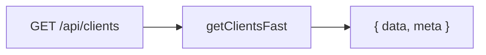

# Accelerar GET /api/clients (< 300 ms)

## Causa

[`src/app.js`](../src/app.js) crida `getClientsSlow()`, que fa **3× `await delay(400)` en sèrie** (~1200 ms) a [`src/db.js`](../src/db.js). Ja existeix `getClientsFast()` amb el mateix format de cada client i **sense delays**.

## Enfocament (concret)

Canvi mínim: cablejar `GET /api/clients` a `getClientsFast`. Sense tocar front, auth ni tests.



## Passos ordenats

1. A [`src/app.js`](../src/app.js): al `require('./db')`, substituir `getClientsSlow` per `getClientsFast`.
2. Al handler `GET /api/clients`, cridar `await getClientsFast()` en lloc de `getClientsSlow()`.
3. Mantenir `{ data, meta: { count, note } }` (mateixes claus). Actualitzar només el text de `meta.note` (p. ex. `'ok'`).
4. No modificar [`src/db.js`](../src/db.js).
5. Validar amb `npm test` i que la resposta de `GET /api/clients` sigui &lt; 300 ms.

## Fitxers

| Fitxer | Acció |
|--------|--------|
| [`src/app.js`](../src/app.js) | Únic canvi: import + crida + text de `note` |
| [`src/db.js`](../src/db.js) | Sense canvis |

## Riscos

- **Reinici oblidat:** sense reiniciar Node, la latència seguirà ~1200 ms.
- **No parallelitzar els 400 ms:** un sol `delay(400)` ja supera 300 ms; cal `getClientsFast`.
- **Format JSON:** no canviar la forma de `data[]` ni l’esquema de `meta`; només el cablejat i el text de `note`.

## Com validar

### Latència

Reiniciar el servidor i comprovar que `GET /api/clients` respon en **&lt; 300 ms**, amb body `{ data, meta }` intacte.

### Terminal local

```bash
npm test
```

Cal que passin tots els tests, especialment `clients amb token retorna llista` (200 + `data.length > 0`). Els tests no mesuren latència; el criteri &lt; 300 ms es valida mesurant la resposta de l’endpoint.
